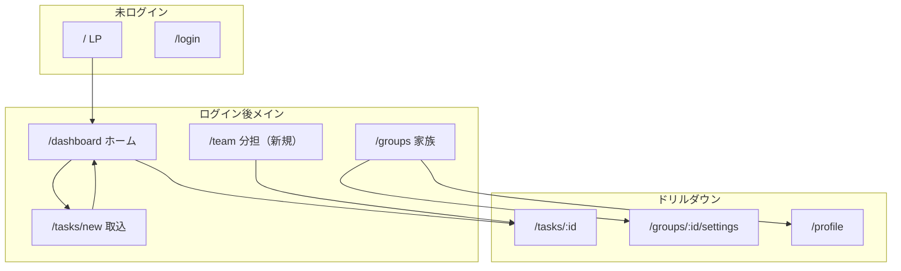

# 育児タスクAI — 目的整理・画面構成再設計プラン（一時ドキュメント）

> **注意**: 作業用の一時ファイルです。内容が固まったら Issue / 正式ドキュメントへ移すか削除してください。  
> 作成日: 2026-10-14

---

## 1. 背景・課題

現状の UI は機能は揃っているが、特に `/dashboard` に **取込・期限・きょうだい・担当・カレンダー・衝突・Workload** が同居し、**1画面に複数の主ジョブ**が載っているため散らかって見える。

| 現状 | 問題 |
|------|------|
| `/dashboard` = 4ビュー + メーター + 衝突 + 複数アクションボタン | ホームの主目的が「今日やる」か「分担」か不明 |
| ナビ「タスク管理」 | 名称が広く、中身は多機能ダッシュボード |
| `/family` → `?view=assignee` リダイレクトのみ | 「家族」という画面が存在しない |
| `/tasks/new` | 取込フローだが入力経路が二重（タブ + ボタン群） |
| レイアウト | `max-w-5xl` / `6xl`、モバイル `pb-20` のばらつき（dashboard 等） |
| 未使用 | `WorkloadBalance.tsx`（`FamilyTeamMeter` と重複） |

---

## 2. 誰の、どんな痛みを解くか

| ペルソナ | 状況 | 痛み |
|----------|------|------|
| 主担当の親 | お便りを読む・転記する | 漏れ、期限見落とし、パートナーへの説明 |
| 協力する親 | 連絡が間接的 | 何をいつやるか見えない、偏って任される |
| きょうだい家庭 | 園・学年が違う | 子どもごとの提出物の混同、同日行事の衝突 |

**位置づけ**: 個人 ToDo アプリではなく **家族共有の実行ボード**。AI は入力摩擦を下げる手段で、ゴールは **期限内に正しい人が動く**。

---

## 3. プロダクト目的

### 一言

> **お便りから家族共有のやることリストを自動で作り、今日誰が何をするかを迷わず終わらせる。**

### 成功のイメージ（成果）

1. **取り込み**: お便り → 確認 → 保存が数分以内
2. **共有**: 家族で未担当・今日期限が分かる（将来は通知）
3. **実行**: 担当が決まり、完了が家全体で見える

### 価値の優先順位（MVP）

```text
① 期限付きタスクが家族に残る（取り込み + 一覧）
② 子ども・担当がタスクに付く（きょうだい + 分担）
③ 偏り・衝突に気づける（メーター + 衝突検知）
```

LP の 01 INGESTION / 02 MULTI-CHILD / 03 TEAM WORKLOAD と一致。**画面もこの3フェーズに沿って配置する。**

### 今は主目的にしないもの

- 汎用プロジェクト管理
- 園の公式連絡ツール代替
- カレンダーアプリ完全代替（補助表示は可）

---

## 4. コアジョブ（J1〜J4）

| ID | ジョブ | 頻度 | 画面の性格 |
|----|--------|------|------------|
| J1 | お便りをタスク化する | 週数回 | 単一フロー・迷わない |
| J2 | 今日・明日やることを終える | 毎日 | 一覧・完了が最速 |
| J3 | 公平に分担する | 週数回 | 誰が何件・未担当が一目 |
| J4 | きょうだい・仕事とぶつからないか | 随時 | 警告は短く・深掘りは任意 |

---

## 5. 再設計の原則

1. **1画面 = 1つの主ジョブ**（副次情報は段階開示）
2. **ボトムナビ = 週次で触る領域だけ**
3. **ビュー切替は同じジョブの見方に限定**（ホーム内4モードは多い）
4. **コピーはユーザーの言葉**（「タスク管理」→「ホーム」など）

---

## 6. 提案サイトマップ



### ボトムナビ（3タブ）— 表示名案

| タブ | 主ジョブ | パス |
|------|----------|------|
| **ホーム** | J2 実行 | `/dashboard` |
| **取込** | J1 お便り→タスク | `/tasks/new` |
| **家族** | J4 土台 + 設定 | `/groups` |

### 分担の置き場（要決定）

| 案 | 内容 | トレードオフ |
|----|------|----------------|
| **A（推奨）** | 分担は **独立ルート `/team`**、ナビは3タブ。ホームから「分担ボード」リンク | 分担は週数回アクセス・ナビがすっきり |
| **B** | 4タブ（ホーム / 取込 / 分担 / 家族） | 明確だがモバイルで窮屈 |

---

## 7. 画面仕様

### 7.1 ホーム `/dashboard`

| 項目 | 内容 |
|------|------|
| 主ジョブ | J2 — 期限順に完了 |
| デフォルトビュー | **期限別**（今日 → 明日 → 今後）。セグメント2番目に「子ども別」 |
| 常時 UI | タイトル「ホーム」、軽い未完了件数、**主 CTA 1つ**（お便りを取込） |
| 条件 UI | 衝突バナー（あれば・折りたたみ） |
| セグメント | `期限` \| `子ども` \| `カレンダー`（担当者別はここから外す） |
| 移す | Workload メーター、担当者カラム → **分担画面** |
| メニュー化 | 更新、手動タスク、仕事の予定 → 「その他」または FAB |

### 7.2 分担 `/team`（新規）

| 項目 | 内容 |
|------|------|
| 主ジョブ | J3 |
| UI | 現 `AssigneeTaskColumns` + 上部 `FamilyTeamMeter` |
| 連携 | 衝突バナー「分担調整」→ ここへ |
| 非ゴール | 期限別の長いリスト（ホームへ戻る） |

旧 `/family` は **`/team` にリダイレクト**。

### 7.3 取込 `/tasks/new`

| 項目 | 内容 |
|------|------|
| 主ジョブ | J1 |
| フロー | 撮影/ファイル → AI 抽出 → 候補編集 → 保存してホーム |
| 簡素化 | 「写真・ファイル」優先。テキスト・音声は「別の入力方法」 |
| 非ゴール | グループ作成（家族画面へ） |

### 7.4 家族 `/groups`

| 項目 | 内容 |
|------|------|
| 主ジョブ | J4 の土台 — メンバー・子ども・グループ |
| 仕事予定 | ホーム「その他」または家族内「予定・衝突」セクション |
| プロフィール | ヘッダー `/profile` のまま |

### 7.5 タスク詳細 `/tasks/[id]`

戻る先・文言を **ホーム** に統一。

---

## 8. 機能配置マトリクス（再設計後）

| 機能 | ホーム | 分担 | 取込 | 家族 |
|------|:------:|:----:|:----:|:----:|
| 今日/明日リスト | ● | | | |
| 子ども別一覧 | ● | | | |
| カレンダー | ● | | | |
| 担当者カラム | | ● | | |
| Workload メーター | | ● | | |
| 衝突アラート（要約） | ● | ○詳細 | | ○仕事予定 |
| お便り AI 抽出 | | | ● | |
| グループ・子ども・招待 | | | | ● |
| 私がやる / 完了 | ● | ● | | |

---

## 9. ナビ・ヘッダー

```text
ヘッダー: ブランド +（デスクトップ）ホーム・取込・家族 + プロフィール
ボトムナビ（モバイル）: ホーム | 取込 | 家族
ホーム内: セグメント + リンク「分担ボード」
```

---

## 10. URL・移行

| 要素 | 推奨 |
|------|------|
| ホーム | `/dashboard` 維持、表示名「ホーム」 |
| 分担 | 新規 `/team`（`?view=assignee` はリダイレクト） |
| 旧 `/family` | `/team` にリダイレクト |
| `WorkloadBalance` | 削除 |
| クエリ `view` | 段階的に整理（`child` / `due` 等、任意） |

---

## 11. 用語統一

| 避ける | 使う |
|--------|------|
| タスク管理（画面名） | **ホーム** |
| お便り取込 / ダッシュボード混在 | **取込** / **ホーム** |
| Workload | **分担のばらつき** または **担当の内訳** |
| 家族・グループ（ナビ） | **家族**（説明でグループ） |

---

## 12. ホーム・分担ワイヤ（テキスト）

### ホーム（期限・デフォルト）

```text
┌─────────────────────────────────┐
│ ホーム          [取込へ →]      │
│ 未完了 12件                     │
├─────────────────────────────────┤
│ ⚠ 衝突2件 [詳細] [分担へ]      │  ← あるときだけ
├─────────────────────────────────┤
│ [期限] [子ども] [カレンダー]     │     分担ボード →
├─────────────────────────────────┤
│ 今日のTODO (3)                  │
│  ☐ 雑巾提出 …  太郎  私がやる   │
│ 明日 / 今後 / 完了済み          │
└─────────────────────────────────┘
│ ホーム │ 取込 │ 家族 │
```

### 分担

```text
┌─────────────────────────────────┐
│ 分担                            │
│ [====メーター====] 未担当 2     │
├─────────────────────────────────┤
│ パパ │ ママ │ 未担当            │
│ （AssigneeTaskColumns）           │
└─────────────────────────────────┘
```

---

## 13. ダッシュボード情報レイヤー（整理指針）

```text
[L0] 固定: タイトル1行 + 主 CTA 1つ（お便りを取込）
[L1] 条件付き: 衝突バナー
[L2] 主コンテンツ: 選択中ビューの一覧
[L3] ビュー依存: Workload は分担画面のみ
[L4] 二次: 更新・仕事予定・手動タスク → メニュー
```

**統合候補**

- ヘッダー「未完了 N件」とツールバー「今日/明日/完了」→ **期限ビュー時のみ** サマリー
- 「新規タスク」と「スキャン」→ スキャン主、手動は取込のテキストモードへ

---

## 14. デザインシステム（実装時の最小セット）

1. **`PageShell`** — `max-w-5xl px-4 pb-20 pt-6` 等を共通化（取込は `wide` 例外可）
2. **`PageHeader`** — title / description / actions
3. **`SegmentedControl`** — ホーム・子どもチップ・取込モードで共用
4. 見出しの `uppercase tracking-wider` は設定系画面に寄せる

---

## 15. 実装フェーズ

| Phase | 内容 |
|-------|------|
| **P0 言語** | ナビ・見出し・LP CTA をホーム/取込/家族に統一 |
| **P1 分割** | `/team` 新設、assignee + FamilyTeamMeter 移動、リダイレクト整理 |
| **P2 ホーム** | デフォルト期限、セグメント3つ、CTA・サマリー整理 |
| **P3 取込** | J1 フロー一本化 |
| **P4 家族** | 子ども・仕事予定の見せ方 |
| **P0' 技術** | PageShell、未使用コンポーネント削除、dashboard `pb-20` |

---

## 16. 未決定事項（要プロダクト判断）

1. **分担**: 独立タブ（4タブ） vs `/team` + ホームリンク（3タブ・推奨）
2. **ホームデフォルト**: 期限別 vs きょうだい別
3. **家族画面**: `/groups` のみ vs プロフィール・仕事予定の統合度

---

## 17. 現行コードとの対応（参考）

| 再設計 | 主な既存コンポーネント / ルート |
|--------|----------------------------------|
| ホーム | `dashboard/page.tsx`, `TaskList`, `SiblingTaskTimeline`, `CalendarView`, `ConflictAlerts` |
| 分担 | `AssigneeTaskColumns`, `FamilyTeamMeter` |
| 取込 | `tasks/new/page.tsx`, `/api/ai/extract` |
| 家族 | `groups/page.tsx`, `groups/[id]/settings` |
| 削除候補 | `WorkloadBalance.tsx` |
